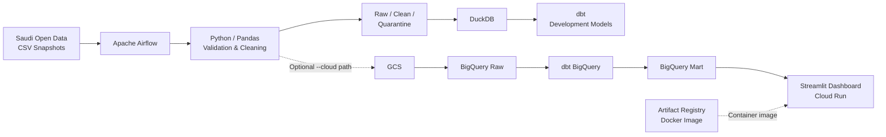
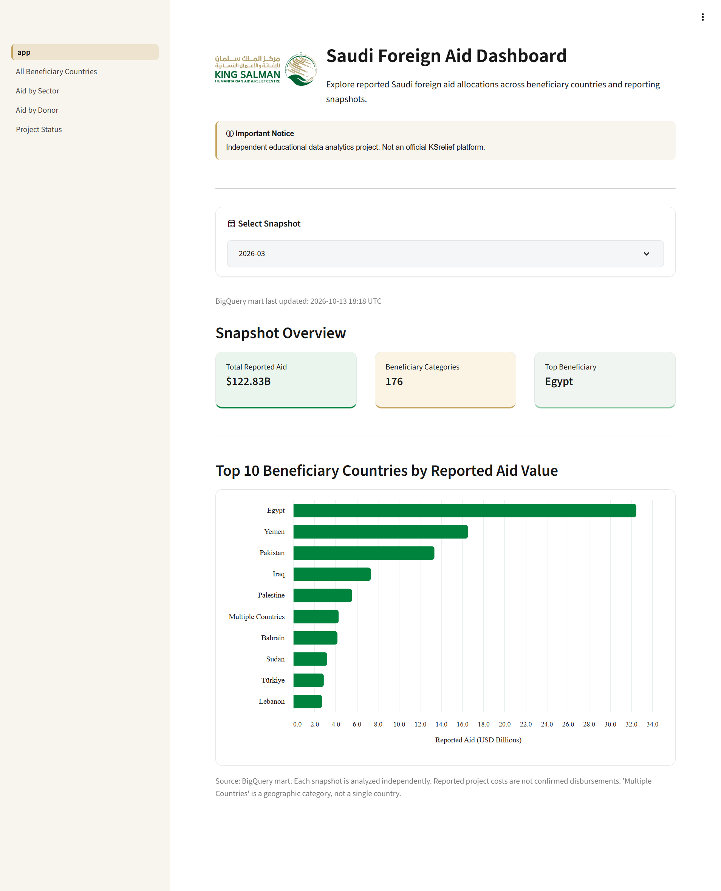

# Saudi Foreign Aid Data Analytics Platform

A batch-oriented data engineering platform that transforms overlapping Saudi
foreign aid CSV releases into validated, standardized, snapshot-aware analytical
datasets and stakeholder-facing dashboards.

## Problem

Saudi foreign aid data is publicly available, but it is not fully analysis-ready.

The published releases contain:

- overlapping historical snapshots,
- inconsistent Arabic column formatting,
- repeated records,
- data-quality issues,
- and no reliable unique project identifier.

The platform standardizes these releases while preserving their historical
snapshot context so reported aid values can be analyzed consistently.

## Core Analytical Questions

The platform supports analysis of:

1. Which beneficiary countries receive the highest reported aid value?
2. Which sectors receive the largest reported aid allocations?
3. Which donor entities contribute the most reported aid?
4. How are project records distributed by status?

Each snapshot is analyzed independently. Overlapping releases are not summed
together as separate aid activity.

---

## Architecture



Airflow currently orchestrates the local development workflow:

```text
prepare_run
    ↓
ingest_snapshot
    ↓
dbt_incremental
```

The Google Cloud analytical path is implemented separately through GCS,
BigQuery, dbt, and Streamlit.

For the detailed architecture, see
[`docs/architecture.md`](docs/architecture.md).

---

## Data Processing

The pipeline:

1. Reads Saudi foreign aid CSV snapshots.
2. Validates contract structure and source schema.
3. Normalizes Arabic source column names.
4. Assigns a sequential `record` number before cleaning.
5. Preserves all source rows in the raw layer.
6. Separates invalid records into quarantine.
7. Standardizes text and project-cost values.
8. Removes standardized exact duplicates within each snapshot.
9. Loads clean analytical data into DuckDB.
10. Builds reusable dbt models.
11. Supports loading cloud data through GCS and BigQuery.
12. Serves analytical metrics through a Streamlit dashboard.

---

## Source Snapshots

The current dataset contains three historical snapshots:

| Snapshot | Raw Records | Clean Records |
|---|---:|---:|
| October 2025 | 8,371 | 7,700 |
| December 2025 | 8,415 | 7,721 |
| March 2026 | 8,802 | 8,001 |
| **Total** | **25,588** | **23,422** |

Source files are staged under:

```text
data/raw/source_a/ingest_date=YYYY-MM-DD/
```

Two date concepts are intentionally separated:

- `ingest_date`: identifies the logical pipeline ingestion run.
- `snapshot_month`: identifies the reporting month represented by the source release.

Several historical snapshots may be processed during the same ingestion run.

---

## Duplicate Handling

The source does not provide a reliable unique project ID.

The platform therefore uses a conservative deduplication strategy:

- raw source records remain preserved,
- fields are standardized before duplicate comparison,
- standardized exact duplicates are removed only within the same snapshot,
- records appearing in different snapshots remain separate historical observations,
- project title and cost are not treated as a global project identifier.

---

## Data Layers

### Raw

Preserves every physical source record.

```text
raw_source_a_records
```

### Clean

Contains validated, standardized, snapshot-scoped deduplicated records.

```text
cleaned_source_a_records
```

### Quarantine

Stores invalid records with quality metadata.

```text
quarantined_source_a_records
```

Quarantined records include:

```text
rejection_reason
quarantined_at
```

---

## Analytical Modeling

The main dbt analytical mart is:

```text
fct_records_by_snapshot
```

Its grain is:

```text
snapshot_month
+ dimension_type
+ dimension_value
```

Supported dimensions:

- `beneficiary_country`
- `project_sector`
- `project_donor`
- `project_status`

Metrics:

- `record_count`
- `total_cost_usd`

dbt supports two targets:

```text
dev       → DuckDB
bigquery  → BigQuery
```

---

## Dashboard



### Live Dashboard

The Streamlit dashboard is deployed on Google Cloud Run and connected to the BigQuery analytical mart.

**[Open Live Dashboard](https://saudi-aid-dashboard-328746085032.europe-west1.run.app)**


The Streamlit dashboard reads from the BigQuery analytical mart:

```text
saudi_aid_dbt_dev.fct_records_by_snapshot
```

Dashboard views include:

- Beneficiary Countries
- Aid by Sector
- Aid by Donor
- Project Status

Every dashboard query filters by `snapshot_month` to prevent aggregation across
overlapping releases.

---

## Reliability and Data Quality

The project includes:

- Apache Airflow orchestration
- Airflow retries with exponential backoff
- Email failure alerts
- Docker Compose
- Airflow Docker healthcheck
- Docker named volume for Airflow logs
- GitHub Actions CI
- pytest
- dbt tests
- Ruff
- Quarantine handling
- Idempotent pipeline re-runs

Validated local row counts after repeated execution remain:

```text
RAW:        25,588
CLEAN:      23,422
QUARANTINE: 0
MART:       702
```

---

## Run Locally

Install the project and development dependencies:

```bash
python -m pip install -e ".[dev]"
```

Run the pipeline for an ingestion date:

```bash
make run RUN_DATE=2026-10-11
```

Run tests:

```bash
make test
```

Run linting:

```bash
make lint
```

### Airflow

Build and start Airflow:

```bash
docker compose up -d --build airflow
```

Check service health:

```bash
docker compose ps
```

The Airflow service should report:

```text
healthy
```

---

## Cloud Path

Run the pipeline with cloud ingestion enabled:

```bash
aid-pipeline run --date 2026-10-11 --cloud
```

Generated raw Parquet data is stored in GCS under:

```text
raw/source_a/ingest_date=YYYY-MM-DD/raw_source_a.parquet
```

The implemented cloud analytical path is:

```text
GCS
 ↓
BigQuery Raw
 ↓
dbt BigQuery
 ↓
BigQuery Analytical Mart
 ↓
Streamlit
```

The current Airflow DAG does not orchestrate this full cloud sequence end-to-end.

---

### Dashboard Deployment on Cloud Run

The Streamlit dashboard is deployed independently of the local Airflow workflow.

Deployment configuration:

- **Platform:** Google Cloud Run
- **Region:** `europe-west1`
- **Service:** `saudi-aid-dashboard`
- **Container Registry:** Google Artifact Registry
- **Dockerfile:** `Dockerfile.dashboard` (multi-stage build)
- **Runtime Identity:** `saudi-aid-dashboard-sa`
- **Data Source:** BigQuery analytical mart (`saudi_aid_dbt_dev`)
- **Scaling:** 0–2 instances

The Cloud Run service uses a dedicated service account with BigQuery Job User
and dataset-level read access. No service account keys are embedded in the image.

The dashboard is publicly accessible for demonstration purposes. Cloud Run
and BigQuery usage may incur costs.

**[Live Dashboard](https://saudi-aid-dashboard-328746085032.europe-west1.run.app)**

---

## Sequential Record Numbering

The pipeline assigns a sequential `record` number to every source row before
cleaning and deduplication.

Current numbering:

- October 2025: `1–8,371`
- December 2025: `8,372–16,786`
- March 2026: `16,787–25,588`

The numbering includes duplicate rows in the raw source.

When duplicates are removed, the retained record preserves its original number,
so gaps in the clean record sequence are expected.

The `record` field is a source-row reference and is **not** a unique aid-project ID.

---

## Data Artifacts

Local generated artifacts include:

```text
data/processed/dev.duckdb
data/processed/raw_source_a.parquet
data/processed/cleaned_source_a.parquet
data/output/fct_records_daily.csv
```

Raw datasets, DuckDB databases, Parquet outputs, generated metrics, local
credentials, and `.env` files must not be committed to Git.

---

## Documentation

- [Architecture](docs/architecture.md)
- [Project Pitch](docs/pitch.md)
- [GCP Setup](docs/gcp_setup.md)
- [Architecture Decisions](docs/decisions/)
- [Data Profiling](docs/profiling/)

---

## Current Scope

The project is intentionally batch-oriented.

The current capstone does not include:

- real-time streaming,
- machine-learning prediction,
- cross-release project identity matching,
- economic or social impact measurement,
- political analysis,
- infrastructure provisioning through Terraform,
- full cloud-native orchestration.

These are outside the current project scope.