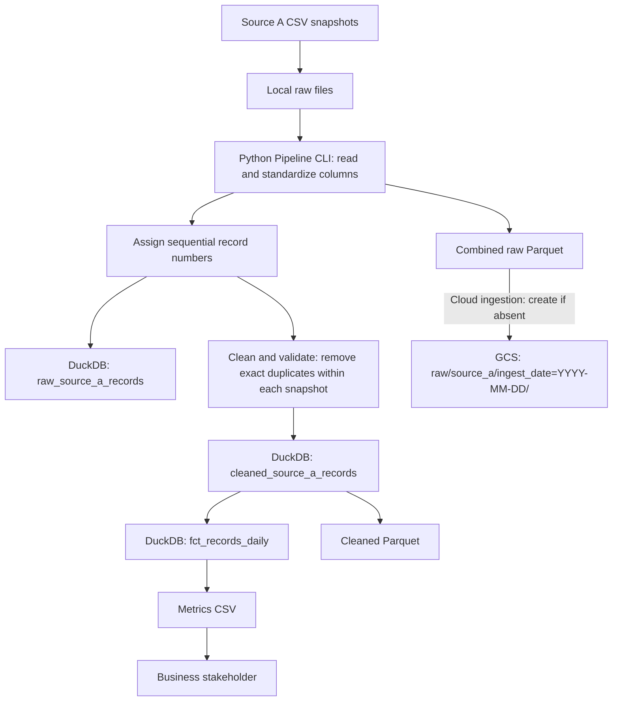

# Saudi Foreign Aid Pipeline — Architecture

## Overview

The Saudi Foreign Aid pipeline processes three historical CSV snapshots using a batch-oriented workflow. The local processing path uses Python, Pandas, and DuckDB to standardize Arabic source fields, preserve numbered raw records, clean and validate records, and generate analytical outputs.

A cloud ingestion component uploads the generated raw Parquet file to Google Cloud Storage (GCS). The local and cloud paths are documented separately below so that the architecture does not imply that all downstream cloud components are orchestrated together.

## Architecture Diagram



The GCS path represents the implemented cloud ingestion step. This diagram does not assert that Airflow, BigQuery, dbt, or Streamlit are already connected to this exact workflow.

## Local Pipeline Implementation

The pipeline supports local batch processing using Python, Pandas, and DuckDB. Three historical CSV snapshots are staged in the local raw-data directory and processed through the Python CLI.

The pipeline standardizes source fields, assigns sequential record numbers, preserves raw records, applies the existing duplicate-handling policy, and produces analytical outputs.

## Local Data Flow

1. Source CSV files are staged in the local raw-data directory.
2. The Python CLI reads the files and standardizes the Arabic column names.
3. The pipeline sorts the snapshots chronologically and assigns a sequential `record` number to each source row before cleaning.
4. Numbered source rows are preserved in the raw layer in DuckDB.
5. The pipeline validates and cleans the source fields, removes exact duplicates within each snapshot using the seven source columns, and preserves the original `record` number of each retained row.
6. Cleaned records are stored in DuckDB and exported to Parquet.
7. Analytical metrics are aggregated by snapshot, beneficiary country, project sector, donor entity, and project status, then exported to CSV.

## Snapshot Handling

The available source snapshots map to these reporting months:

- `25M10` → `2025-10`
- `25M12` → `2025-12`
- `26M03` → `2026-03`

### Ingestion Date vs. Snapshot Month

The pipeline distinguishes between two dates:

- `ingest_date`: The logical date used to organize and track an ingestion run in GCS.
- `snapshot_month`: The reporting period represented by the original source CSV.

Multiple historical snapshots may be processed during the same ingestion run. The fields serve different purposes and must not be treated as interchangeable.

In the local warehouse workflow, reprocessing a snapshot replaces its existing rows while preserving rows from other snapshots. This behavior is separate from GCS object immutability, described below.

## Local Outputs

- `data/processed/dev.duckdb`: Local analytical warehouse.
- `data/processed/cleaned_source_a.parquet`: Cleaned records.
- `data/output/fct_records_daily.csv`: Analytical metrics for stakeholders.

## Google Cloud Integration

The pipeline includes an implemented cloud ingestion component that uploads a generated raw Parquet file to Google Cloud Storage. The uploaded Parquet can contain records from multiple historical snapshots, distinguished by `snapshot_month`.

This GCS object is a generated Parquet dataset; it should not be described as a byte-for-byte archival copy of the original CSV files.

## GCS Ingestion and Idempotency

The cloud ingestion process organizes uploaded raw Parquet files by `ingest_date`.

**GCS object path:**

```text
raw/source_a/ingest_date=YYYY-MM-DD/raw_source_a.parquet
```

### Idempotency Strategy

- Repeated runs targeting the same GCS object path reuse the existing object rather than uploading a second copy to that path.
- Existing objects are protected from overwrites through create-only upload behavior.
- Temporary cloud failures are handled using retries with exponential backoff.
- Concurrent attempts to create the same object are handled by reusing the object created by another run.
- Scheduled retries, including future Airflow retries, should use the same logical `ingest_date`.
- `snapshot_month` remains available to identify historical source snapshots.
- Existing record-numbering and duplicate-handling policies are unchanged by the cloud ingestion feature.

### Limitations

- Idempotency applies to the same destination object path, not to identical data uploaded under different ingestion dates.
- Processing the same data with a different `ingest_date` may create another GCS object.
- If source data changes after an object has been created for a particular ingestion date, that existing object is not automatically replaced.
- Reprocessing changed data for an existing ingestion date requires an explicit versioning or replacement strategy.
- This ingestion policy does not, by itself, guarantee deduplication in downstream warehouse tables or dbt models.

## Downstream Components and Orchestration

BigQuery, dbt, Airflow, and Streamlit are part of the broader project work. Their connections, scheduling behavior, and deployment status should be documented against the corresponding merged implementations. This document does not assume that the GCS ingestion step is already orchestrated end-to-end through those components.
