# Saudi Foreign Aid Data Analytics Platform — Architecture

## Overview

The Saudi Foreign Aid Data Analytics Platform transforms overlapping Saudi foreign aid CSV releases into validated, standardized, snapshot-aware analytical datasets.

The platform uses a batch-oriented architecture with two complementary paths:

- **Local development path:** Airflow, Python/Pandas, DuckDB, and dbt.
- **Cloud analytical path:** Google Cloud Storage, BigQuery, dbt, and Streamlit.

The system preserves raw records, validates incoming data, quarantines invalid records, removes standardized exact duplicates within each snapshot, and produces reusable analytical models.

Historical releases are treated as overlapping snapshots and are analyzed independently rather than summed together.

---

## Architecture Diagram

```mermaid
flowchart LR

    subgraph SOURCE["1 · Data Source"]
        A["Saudi Open Data<br/>CSV Snapshots<br/>25M10 · 25M12 · 26M03"]
    end

    subgraph ORCH["2 · Local Orchestration"]
        B["Apache Airflow"]
        B1["prepare_run"]
        B2["ingest_snapshot"]
        B3["dbt_incremental"]

        B --> B1 --> B2 --> B3
    end

    subgraph PROCESS["3 · Processing & Data Quality"]
        C1["Contract & Source<br/>Validation"]
        C2["Schema<br/>Standardization"]
        C3["Assign record +<br/>snapshot_month"]
        C4["Record Validation"]
        C5["Cleaning &<br/>Deduplication"]
        CQ["Quarantine"]

        C1 --> C2 --> C3 --> C4
        C4 -->|"Valid"| C5
        C4 -->|"Invalid"| CQ
    end

    subgraph LOCAL["4 · Local Development"]
        D1["DuckDB<br/>Raw"]
        D2["DuckDB<br/>Clean"]
        D3["DuckDB<br/>Quarantine"]
        D4["dbt dev"]
        D5["Analytical Mart"]
    end

    subgraph CLOUD["5 · Cloud Analytics"]
        E1["Raw Parquet"]
        E2["Google Cloud Storage"]
        E3["BigQuery Raw"]
        E4["dbt BigQuery"]
        E5["BigQuery Mart"]
    end

    subgraph SERVING["6 · Serving"]
        F["Streamlit Dashboard"]
    end

    subgraph REL["7 · Reliability"]
        G1["GitHub Actions"]
        G2["pytest + dbt Tests + Ruff"]
        G3["Docker Healthcheck"]
        G4["Airflow Retries + Alerts"]
        G5["Idempotent Re-runs"]
    end

    A --> B
    B2 --> C1

    C3 --> D1
    C5 --> D2
    CQ --> D3
    D2 --> D4 --> D5

    C3 -. "Optional --cloud path" .-> E1
    E1 --> E2 -->|"BigQuery loader"| E3
    E3 --> E4 --> E5
    E5 --> F

    G1 --> G2
    G3 -.-> B
    G4 -.-> B
    G5 -.-> B

    classDef source fill:#E8F3EE,stroke:#245C47,stroke-width:2px;
    classDef orch fill:#EAF0F8,stroke:#345A84,stroke-width:2px;
    classDef process fill:#F6EFE2,stroke:#8A6935,stroke-width:2px;
    classDef local fill:#EEF0F2,stroke:#59636E,stroke-width:2px;
    classDef cloud fill:#E8F1FA,stroke:#3F6D98,stroke-width:2px;
    classDef serving fill:#F1EAF5,stroke:#725786,stroke-width:2px;
    classDef reliability fill:#F8ECEC,stroke:#8A4D4D,stroke-width:2px;

    class A source;
    class B,B1,B2,B3 orch;
    class C1,C2,C3,C4,C5,CQ process;
    class D1,D2,D3,D4,D5 local;
    class E1,E2,E3,E4,E5 cloud;
    class F serving;
    class G1,G2,G3,G4,G5 reliability;
```



---

## Data Flow

1. Saudi foreign aid CSV snapshots are staged for processing.
2. Airflow validates the run and detects available snapshot months.
3. The Python pipeline validates and standardizes the source schema.
4. Each source row receives a sequential `record` number and `snapshot_month`.
5. Raw records are preserved for traceability.
6. Invalid records are routed to quarantine.
7. Valid records are cleaned and deduplicated within the same snapshot.
8. Clean records are loaded into DuckDB for local development.
9. dbt builds the analytical mart.
10. The cloud path loads data through GCS and BigQuery.
11. Streamlit queries the BigQuery analytical mart for stakeholder analysis.

---

## Data Layers

### Raw

Preserves all physical source rows, including duplicates.

```text
raw_source_a_records
```

### Clean

Contains validated, standardized, snapshot-scoped deduplicated records.

```text
cleaned_source_a_records
```

### Quarantine

Stores invalid records with quality metadata.

```text
quarantined_source_a_records
```

Quarantined rows include:

```text
rejection_reason
quarantined_at
```

---

## Snapshot and Duplicate Strategy

The project currently processes three historical snapshots:

| Source Release | Snapshot Month |
|---|---|
| `25M10` | `2025-10` |
| `25M12` | `2025-12` |
| `26M03` | `2026-03` |

The source does not provide a reliable unique project ID.

The platform therefore uses a conservative deduplication strategy:

- text and cost fields are standardized first,
- exact standardized duplicates are removed only within the same `snapshot_month`,
- identical records appearing in different snapshots are preserved,
- raw records remain unchanged,
- snapshots are never summed together as independent aid activity.

---

## Analytical Modeling

dbt supports two targets:

```text
dev       → DuckDB
bigquery  → BigQuery
```

The primary analytical mart is:

```text
fct_records_by_snapshot
```

Its grain is:

```text
snapshot_month
+ dimension_type
+ dimension_value
```

Supported analytical dimensions:

- `beneficiary_country`
- `project_sector`
- `project_donor`
- `project_status`

Metrics:

- `record_count`
- `total_cost_usd`

---

## Local and Cloud Paths

### Local Development Path

Airflow currently orchestrates:

```text
CSV
→ Python Pipeline
→ DuckDB
→ dbt dev
```

The Airflow DAG contains:

```text
prepare_run
    ↓
ingest_snapshot
    ↓
dbt_incremental
```

### Cloud Analytical Path

The implemented cloud path is:

```text
Python --cloud
→ GCS
→ BigQuery Raw
→ dbt BigQuery
→ BigQuery Analytical Mart
→ Streamlit
```

The current Airflow DAG does not orchestrate this complete cloud sequence end-to-end.

---

## Reliability and Data Quality

The platform includes:

- Contract structure validation
- Source schema validation
- Quarantine handling
- Snapshot-scoped deduplication
- Airflow retries with exponential backoff
- Email failure alerts
- Docker Airflow healthcheck
- GitHub Actions CI
- pytest
- dbt tests
- Ruff
- Idempotent pipeline re-runs

Validated local results:

| Layer | Rows |
|---|---:|
| Raw | 25,588 |
| Clean | 23,422 |
| Quarantine | 0 |
| Analytical Mart | 702 |

---

## Dashboard

The Streamlit dashboard reads from the BigQuery analytical mart and answers:

1. Which beneficiary countries receive the highest reported aid value?
2. Which sectors receive the largest reported aid allocations?
3. Which donor entities contribute the most reported aid?
4. How are project records distributed by status?

Every dashboard query filters by `snapshot_month` to avoid combining overlapping releases incorrectly.

---

## Current Architecture Boundaries

The current project is intentionally batch-oriented.

It does not include:

- real-time streaming,
- machine-learning prediction,
- cross-release project identity matching,
- full cloud-native orchestration,
- infrastructure provisioning through Terraform.

For larger datasets, more transformation logic could be moved from Pandas to SQL-native processing in DuckDB or BigQuery.