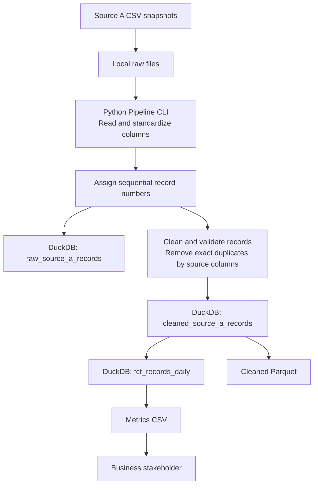

# Saudi Foreign Aid Pipeline — Architecture

## Current implementation

The pipeline currently runs locally on one laptop using Python, Pandas, and DuckDB. The three source CSV snapshots are placed in the local raw-data directory before the pipeline runs.

## Data flow

1. Source CSV files are staged in the local raw-data directory.
2. The Python CLI reads the files and standardizes the Arabic column names.
3. The pipeline sorts the snapshots chronologically and assigns a sequential `record` number to every source row before cleaning.
4. All numbered source rows are preserved in the raw layer in DuckDB.
5. The pipeline validates and cleans the source fields, removes exact duplicates within each snapshot using the seven source columns, and preserves the original `record` number of each retained row.
6. Cleaned records are stored in DuckDB and exported to Parquet.
7. Analytical metrics are aggregated by snapshot, beneficiary country, project sector, donor entity, and project status, then exported to CSV.

## Snapshot handling

* `25M10` maps to `2025-10`.
* `25M12` maps to `2025-12`.
* `26M03` maps to `2026-03`.

The `ingest_date` directory records when the files were brought into the local project. `snapshot_month` identifies the source snapshot. These dates serve different purposes.

Reprocessing a snapshot replaces its existing warehouse rows while preserving rows from the other snapshots.

## Current outputs

* `data/processed/dev.duckdb`: local analytical warehouse.
* `data/processed/cleaned_source_a.parquet`: cleaned records.
* `data/output/fct_records_daily.csv`: metrics for stakeholders.

## Planned Google Cloud integration

Google Cloud Storage is planned for preserving the original raw CSV snapshots. The current pipeline still reads files staged locally; automated upload to and retrieval from Cloud Storage have not yet been implemented.

BigQuery and Streamlit are not part of the current implementation. Any future cloud warehouse or dashboard should be documented when the team agrees on the design and implements it.
