# Saudi Foreign Aid Data Analytics Platform — Architecture

## Overview

The Saudi Foreign Aid Data Analytics Platform transforms overlapping Saudi foreign aid CSV releases into validated, standardized, snapshot-aware analytical datasets.

The platform follows a batch-oriented architecture with two complementary paths:

- **Local development and orchestration path:** Airflow, Python/Pandas, DuckDB, and dbt.
- **Cloud analytical path:** Google Cloud Storage, BigQuery, dbt, and Streamlit.

The architecture preserves raw source records for traceability, validates source structure, standardizes inconsistent Arabic schemas, quarantines invalid records, removes standardized exact duplicates only within each snapshot, and produces reusable analytical models.

Historical releases are overlapping snapshots and are therefore analyzed independently rather than summed together as separate aid data.

---

## Architecture Diagram

```mermaid
flowchart LR

    subgraph SOURCE["1 · Data Source"]
        A["Saudi Open Data<br/>CSV Snapshots<br/>25M10 · 25M12 · 26M03"]
    end

    subgraph ORCH["2 · Local Orchestration"]
        B["Apache Airflow"]
        B1["prepare_run<br/>Validate run date<br/>Detect snapshot months"]
        B2["ingest_snapshot<br/>Run Python pipeline"]
        B3["dbt_incremental<br/>dbt --target dev"]

        B --> B1 --> B2 --> B3
    end

    subgraph PROCESS["3 · Ingestion & Data Quality"]
        C1["Contract Structure<br/>Validation"]
        C2["Source Schema<br/>Validation"]
        C3["Normalize Arabic<br/>Column Names"]
        C4["Assign record +<br/>snapshot_month"]
        C5["Record Validation"]
        C6["Standardization<br/>& Cleaning"]
        C7["Snapshot-scoped<br/>Deduplication"]
        CQ["Quarantine<br/>Invalid Records"]

        C1 --> C2 --> C3 --> C4 --> C5
        C5 -->|"Valid"| C6 --> C7
        C5 -->|"Invalid"| CQ
    end

    subgraph LOCAL["4 · Local Development Path"]
        D1["DuckDB<br/>Raw"]
        D2["DuckDB<br/>Clean"]
        D3["DuckDB<br/>Quarantine"]
        D4["dbt Staging<br/>View"]
        D5["dbt Analytical Mart<br/>fct_records_by_snapshot"]
    end

    subgraph CLOUD["5 · Google Cloud Analytical Path"]
        E1["Raw Parquet"]
        E2["Google Cloud Storage<br/>GCS"]
        E3["BigQuery Raw<br/>saudi_aid_raw"]
        E4["dbt<br/>BigQuery Target"]
        E5["BigQuery Analytical Mart<br/>saudi_aid_dbt_dev"]
    end

    subgraph SERVING["6 · Analytics & Serving"]
        F["Streamlit Dashboard"]
        F1["Beneficiary Countries"]
        F2["Aid by Sector"]
        F3["Aid by Donor"]
        F4["Project Status"]

        F --> F1
        F --> F2
        F --> F3
        F --> F4
    end

    subgraph REL["7 · Reliability & Quality"]
        G1["GitHub Actions CI"]
        G2["pytest"]
        G3["dbt Tests"]
        G4["Ruff"]
        G5["Docker Healthcheck"]
        G6["Airflow Retries<br/>+ Exponential Backoff"]
        G7["Email Failure Alerts"]
        G8["Idempotent Re-runs"]
    end

    A --> B
    B2 --> C1

    C4 --> D1
    C7 --> D2
    CQ --> D3
    D2 --> D4 --> D5

    C4 -. "Optional --cloud path" .-> E1
    E1 --> E2
    E2 -->|"BigQuery loader"| E3
    E3 --> E4 --> E5
    E5 --> F

    G1 --> G2
    G1 --> G3
    G1 --> G4
    G5 -.-> B
    G6 -.-> B
    G7 -.-> B
    G8 -.-> B

    classDef source fill:#E8F3EE,stroke:#245C47,stroke-width:2px;
    classDef orch fill:#EAF0F8,stroke:#345A84,stroke-width:2px;
    classDef process fill:#F6EFE2,stroke:#8A6935,stroke-width:2px;
    classDef local fill:#EEF0F2,stroke:#59636E,stroke-width:2px;
    classDef cloud fill:#E8F1FA,stroke:#3F6D98,stroke-width:2px;
    classDef serving fill:#F1EAF5,stroke:#725786,stroke-width:2px;
    classDef reliability fill:#F8ECEC,stroke:#8A4D4D,stroke-width:2px;

    class A source;
    class B,B1,B2,B3 orch;
    class C1,C2,C3,C4,C5,C6,C7,CQ process;
    class D1,D2,D3,D4,D5 local;
    class E1,E2,E3,E4,E5 cloud;
    class F,F1,F2,F3,F4 serving;
    class G1,G2,G3,G4,G5,G6,G7,G8 reliability;
```



---

## Data Source

The project currently processes three Saudi foreign aid releases:

| Source Release | Snapshot Month |
|---|---|
| `25M10` | `2025-10` |
| `25M12` | `2025-12` |
| `26M03` | `2026-03` |

The releases are overlapping historical snapshots rather than independent datasets.

For this reason, analytical metrics are calculated within individual snapshots and the releases must not be summed together as separate aid observations.

---

## Ingestion Date vs. Snapshot Month

The platform distinguishes between two dates.

### `snapshot_month`

The reporting month represented by the original source release.

### `ingest_date`

The logical date used to organize and execute an ingestion run.

Several historical snapshots may therefore be processed during the same ingestion run.

These two fields serve different purposes and must not be treated as interchangeable.

---

## Local Orchestration

Apache Airflow orchestrates the local development and validation workflow.

The DAG is:

```text
saudi_foreign_aid_pipeline
```

Its main task sequence is:

```text
prepare_run
    ↓
ingest_snapshot
    ↓
dbt_incremental
```

### `prepare_run`

- Validates the ingestion date format.
- Verifies that the ingestion directory exists.
- Detects CSV files.
- Extracts `snapshot_month` values from filenames.
- Prevents duplicate snapshot months within the same run.
- Passes runtime values to downstream tasks.

### `ingest_snapshot`

Runs the Python pipeline using:

```text
aid-pipeline run --date <run_date>
```

### `dbt_incremental`

Builds the dbt development models using:

```text
dbt build --target dev
```

The `dev` target uses DuckDB.

The current Airflow DAG does not orchestrate the full Google Cloud analytical path.

---

## Source and Contract Validation

Validation occurs at multiple levels.

### Contract Structure Validation

YAML data contracts are validated for:

- Supported schema version
- Dataset definition
- Column definitions
- Allowed data types
- Nullability configuration
- Duplicate column names
- Primary-key references

### Source Schema Validation

The CSV reader validates the incoming source structure by:

- Normalizing Arabic header formatting
- Mapping Arabic source columns to standardized English analytical names
- Rejecting unexpected source columns
- Detecting missing required columns
- Rejecting multiple source columns that map to the same analytical field
- Supporting UTF-8 and Windows Arabic encodings

---

## Record Processing

Each source snapshot follows this sequence:

```text
Read CSV
   ↓
Normalize source headers
   ↓
Assign sequential record number
   ↓
Assign snapshot_month
   ↓
Preserve Raw Record
   ↓
Validate Record
  ↙       ↘
Valid    Invalid
  ↓         ↓
Clean    Quarantine
  ↓
Standardize fields
  ↓
Snapshot-scoped deduplication
  ↓
Clean analytical record
```

Sequential `record` numbers are assigned before cleaning.

This allows the retained analytical records to remain traceable to their original physical source rows.

---

## Raw, Clean, and Quarantine Layers

### Raw Layer

The raw layer preserves every source row, including duplicate records.

Local table:

```text
raw_source_a_records
```

### Clean Layer

Valid records are standardized and deduplicated for analytical use.

Local table:

```text
cleaned_source_a_records
```

### Quarantine Layer

Invalid records are separated from the analytical dataset instead of silently discarded.

Local table:

```text
quarantined_source_a_records
```

Quarantined rows include:

- `rejection_reason`
- `quarantined_at`

This keeps invalid source records observable and traceable.

---

## Conservative Deduplication Strategy

The source does not provide a reliable unique project identifier.

The platform therefore avoids attempting to identify the same project across different releases.

During cleaning:

1. Text fields are trimmed.
2. Project cost values are standardized to numeric values.
3. Deduplication is performed using the seven standardized source fields.
4. Deduplication is scoped to the current `snapshot_month`.
5. The earliest assigned `record` number is retained.
6. Identical records appearing in different snapshots remain separate historical observations.

Project title and project cost are not treated as a global project identifier.

This strategy reduces over-counting while avoiding unsupported cross-release entity resolution.

---

## Local Warehouse

DuckDB is used as the local development warehouse.

Database:

```text
data/processed/dev.duckdb
```

Main local tables include:

```text
raw_source_a_records
cleaned_source_a_records
quarantined_source_a_records
```

The local warehouse uses snapshot-aware loading where appropriate. Because global
record numbering depends on the complete ordered snapshot set, pipeline runs must
include all snapshots already present in the warehouse before rebuilding the
clean analytical layer.

---

## dbt Modeling

dbt supports both local DuckDB development and BigQuery analytical execution.

### Development Target

```text
target: dev
type: duckdb
schema: dbt_dev
```

### Cloud Target

```text
target: bigquery
project: saudi-foreign-aid-data
dataset: saudi_aid_dbt_dev
location: europe-west1
```

The staging model performs compatible transformations for both DuckDB and BigQuery.

---

## dbt Staging Model

The staging model:

```text
stg_source_a__records
```

performs:

- Text trimming
- Project cost normalization
- Snapshot-aware deduplication

Duplicate comparison uses:

```text
snapshot_month
project_title
project_status
project_sector
project_location
total_cost_usd
project_donor
beneficiary_country
```

---

## Analytical Mart

The primary analytical mart is:

```text
fct_records_by_snapshot
```

Its grain is:

```text
snapshot_month
+ dimension_type
+ dimension_value
```

Supported analytical dimensions are:

- `beneficiary_country`
- `project_sector`
- `project_donor`
- `project_status`

The mart provides:

- `record_count`
- `total_cost_usd`

The model is incremental and uses the following logical unique key:

```text
snapshot_month
+ dimension_type
+ dimension_value
```

---

## Local Data Volumes

The validated local pipeline currently produces:

| Layer | Rows |
|---|---:|
| Raw source records | 25,588 |
| Clean analytical records | 23,422 |
| Quarantined records | 0 |
| Analytical mart | 702 |

Repeated execution for the same ingestion date produces the same row counts, confirming idempotent local behavior.

---

## Google Cloud Analytical Path

The cloud analytical components are implemented separately from the current Airflow DAG.

### Google Cloud Storage

Running the pipeline with:

```text
aid-pipeline run --date <run_date> --cloud
```

uploads the generated raw Parquet dataset to Google Cloud Storage.

Object structure:

```text
raw/source_a/ingest_date=YYYY-MM-DD/raw_source_a.parquet
```

The GCS ingestion logic supports:

- Create-only object behavior
- Detection of existing objects
- Retry handling for temporary cloud failures
- Exponential retry backoff
- Safe handling of concurrent object creation

---

## BigQuery Raw Layer

Raw Parquet data can be loaded from GCS into the BigQuery raw dataset:

```text
saudi_aid_raw
```

The BigQuery loader provides the bridge between the cloud storage layer and the BigQuery warehouse.

dbt then uses:

```text
saudi_aid_raw.raw_source_a_records
```

as its BigQuery source.

---

## BigQuery Analytical Layer

The dbt BigQuery target creates analytical models in:

```text
saudi_aid_dbt_dev
```

The main analytical mart is:

```text
saudi_aid_dbt_dev.fct_records_by_snapshot
```

This mart is the serving source for the dashboard.

---

## Streamlit Dashboard

The Streamlit dashboard queries the BigQuery analytical mart directly.

It supports the project's primary stakeholder questions:

1. Which beneficiary countries receive the highest reported aid value?
2. Which sectors receive the largest reported aid allocations?
3. Which donor entities contribute the most reported aid?
4. How are project records distributed by status?

Every dashboard query filters by `snapshot_month`.

This prevents overlapping source releases from being incorrectly aggregated together.

The dashboard also displays the last modification time of the BigQuery analytical mart.

---

## Reliability and Quality

The platform includes several operational controls.

### Continuous Integration

GitHub Actions runs automated repository checks.

### Automated Tests

The project includes:

- Python unit tests
- Integration tests
- Airflow DAG tests
- dbt tests
- Cloud smoke testing

### Code Quality

Ruff is used for Python static analysis.

### Airflow Reliability

Airflow provides:

- Task retries
- Exponential retry backoff
- Failure callbacks
- Email failure alerts

### Docker Runtime Health

Docker Compose includes an Airflow healthcheck using:

```text
http://localhost:8080/health
```

Airflow logs use a Docker named volume to avoid host filesystem ownership issues across development environments.

### Idempotency

Repeated pipeline runs for the same logical data do not duplicate the validated local warehouse results.

---

## Authentication and Security

Local Google Cloud authentication uses Application Default Credentials (ADC).

The project uses a dedicated runtime service account with scoped access to the required Google Cloud resources.

Service account JSON credentials are not committed to the repository.

Secrets such as SMTP credentials are supplied through environment variables or local `.env` configuration.

The `.env` file remains excluded from Git.

---

## Current Architecture Boundary

The current system is intentionally batch-oriented.

Airflow currently orchestrates:

```text
CSV
→ Python Pipeline
→ DuckDB
→ dbt dev
```

The implemented cloud analytical path is:

```text
Python --cloud
→ GCS
→ BigQuery Raw
→ dbt BigQuery
→ BigQuery Analytical Mart
→ Streamlit
```

These cloud components are implemented, but the current Airflow DAG does not orchestrate the complete cloud sequence end-to-end.

A future production deployment could orchestrate this path using Airflow, Cloud Composer, Cloud Workflows, or another suitable managed orchestration service.

---

## Scope Boundaries

The current project does not include:

- Real-time streaming
- Machine-learning prediction
- Cross-release project identity matching
- Economic or social impact measurement
- Infrastructure provisioning through Terraform
- Full cloud-native orchestration

These areas are outside the current capstone scope.

---

## Scalability Considerations

The current architecture safely supports the existing low-volume batch workload of approximately 25,000 source rows.

The primary scalability constraint is the Python/Pandas processing layer because snapshot files are processed in memory.

At larger scale, transformation work can be shifted toward SQL-native processing in DuckDB or BigQuery, reducing memory pressure in the Python runtime.

Cloud execution can also be extended using serverless or managed orchestration services when required.

---

## Architecture Summary

```text
Saudi Open Data CSV Snapshots
              ↓
         Apache Airflow
              ↓
       Python / Pandas
              ↓
Validation + Standardization
              ↓
   Raw ── Clean ── Quarantine
              ↓
           DuckDB
              ↓
          dbt dev
              ↓
     Local Analytical Mart


Cloud Analytical Path:

Python --cloud
      ↓
Raw Parquet
      ↓
GCS
      ↓
BigQuery Raw
      ↓
dbt BigQuery
      ↓
BigQuery Analytical Mart
      ↓
Streamlit Dashboard


Reliability:

GitHub Actions
pytest
dbt Tests
Ruff
Docker Healthcheck
Airflow Retries
Email Failure Alerts
Idempotent Re-runs
```
