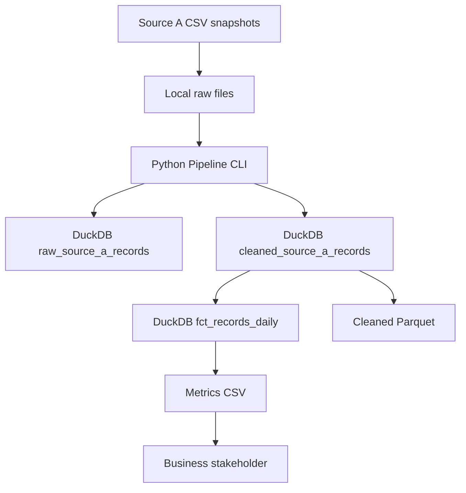

# Saudi Foreign Aid Pipeline — Architecture

## Current implementation

The pipeline currently runs locally on one laptop using Python, Pandas, and DuckDB. The three source CSV snapshots are placed in the local raw-data directory before the pipeline runs.

## Data flow

1. Source CSV files are placed in the local raw-data directory.
2. The Python CLI reads the files and standardizes Arabic column names.
3. The pipeline derives `snapshot_month` from each source filename.
4. Raw and cleaned records are loaded into DuckDB.
5. Exact duplicate records are removed within each snapshot only.
6. Metrics are aggregated separately by snapshot, beneficiary country, project sector, project donor, and project status.
7. Cleaned records are exported to Parquet, and metrics are exported to CSV.

## Snapshot handling

* `25M10` maps to `2025-10`.
* `25M12` maps to `2025-12`.
* `26M03` maps to `2026-03`.

The `ingest_date` directory records when the files were brought into the local project. `snapshot_month` identifies the source snapshot. These dates serve different purposes.

Reprocessing a snapshot replaces its existing warehouse rows while preserving rows from the other snapshots.

## Current outputs

* `data/processed/dev.duckdb`: local analytical warehouse.
* `data/processed/cleaned_source_a.parquet`: cleaned records.
* `data/output/fct_records_daily.csv`: metrics for stakeholders.

## Planned Google Cloud integration

Google Cloud Storage is planned for preserving the original raw CSV snapshots. The current pipeline still reads files staged locally; automated upload to and retrieval from Cloud Storage have not yet been implemented.

BigQuery and Streamlit are not part of the current implementation. Any future cloud warehouse or dashboard should be documented when the team agrees on the design and implements it.
